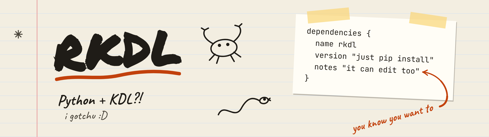

<p align="center">
  <picture>
    <source media="(prefers-color-scheme: dark)" srcset="https://raw.githubusercontent.com/auroral-cat/rkdl/main/.github/assets/banner-dark.png">
    
  </picture>
</p>

rkdl reads and edits [KDL](https://kdl.dev) v2 documents from Python, using [kdl-rs](https://github.com/kdl-org/kdl-rs)
underneath. When you edit a file and save it, everything you didn't touch stays as it was, comments and spelling
included.

## Install

rkdl isn't on PyPI yet, so install it from git:

```sh
uv add "rkdl @ git+https://github.com/auroral-cat/rkdl@v0.1.0"
# or
pip install "rkdl @ git+https://github.com/auroral-cat/rkdl@v0.1.0"
```

This builds it from source, so you need a Rust toolchain (from [rustup](https://rustup.rs), for example). rkdl needs
Python 3.10 or newer.

## A short tour

Say `server.kdl` looks like this:

```kdl
// Where the app listens
server "web" port=0x1F90 {
    host "localhost"
    workers 4
}
logging level="info"
```

Load it and read some values:

```python
import rkdl

doc = rkdl.load("server.kdl")

server = doc["server"]
print(server.args[0])             # web
print(server.props["port"])       # 8080
print(server["workers"].args[0])  # 4
```

Change two values, add a node, remove another, and save:

```python
server.props["port"] = 9090
server["workers"].args[0] = 8
server.children.append(rkdl.Node("timeout", 30))
doc["logging"].detach()

rkdl.dump(doc, "server.kdl")
```

`server.kdl` is now:

```kdl
// Where the app listens
server "web" port=0x2382 {
    host "localhost"
    workers 8
    timeout 30
}
```

The comment is still there, the port is still written in hex, and the new node got the same indentation as its
siblings. `rkdl.parse(text)` and `str(doc)` do the same as `load` and `dump` with strings.

## Finding nodes

`doc["name"]` gives the first node with that name, and raises `KeyError` if there's none. A `(type, name)` pair also
matches the type annotation. `get(key, default)` returns the default instead of raising, `get_all(key)` returns every
match, and `key in doc` checks whether there is one. Nodes work the same way for their children.

```python
text = """\
package "rkdl"
(dev)dependency "pytest"
dependency "hypothesis"
scripts {
    test "pytest"
}
"""
doc = rkdl.parse(text)

first_dependency = doc["dependency"]           # matches any type: this is (dev)dependency
dev_dependency = doc[("dev", "dependency")]
all_dependencies = doc.get_all("dependency")
license_node = doc.get("license")              # None
has_scripts = "scripts" in doc                 # True
```

Iterating over a document or a node gives its children. `iter()` walks all the descendants depth first, and
`iter(name)` keeps only the ones with that name:

```python
top_level_names = [node.name for node in doc]
# ['package', 'dependency', 'dependency', 'scripts']
every_name = [node.name for node in doc.iter()]
# ['package', 'dependency', 'dependency', 'scripts', 'test']
test_parents = [node.parent.name for node in doc.iter("test")]
# ['scripts']
```

## Arguments and properties

`node.args` is a live list of the node's arguments, and `node.props` a live dict of its properties, both as plain
Python values. Changing them changes the document.

```python
doc = rkdl.parse('dependency (dev)"pytest" "hypothesis" version=">=8" optional=#true\n')
dependency = doc["dependency"]

print(dependency.args)   # Args(['pytest', 'hypothesis'])
print(dependency.props)  # Props({'version': '>=8', 'optional': True})

dependency.args.append("ruff")
dependency.props["version"] = ">=9"
del dependency.props["optional"]
print(doc)
# dependency (dev)"pytest" "hypothesis" ruff version=">=9"
```

`node.entries` lists every argument and property in file order, as `Entry` objects. An entry has a `name` (`None`
for an argument), a `type` and a `value`, and you can set all three. `args.entry(index)` and `props.entry(key)` get
a single one.

```python
for entry in dependency.entries:
    print(entry.name, entry.type, entry.value)
# None dev pytest
# None None hypothesis
# None None ruff
# version None >=9

version_entry = dependency.props.entry("version")
version_entry.name = "min-version"
print(doc)
# dependency (dev)"pytest" "hypothesis" ruff min-version=">=9"
```

## Children and moving nodes

`node.children` is a live list of nodes. It's `None` when the node has no `{ }` block. Assigning `[]` adds an empty
block and assigning `None` removes it.

A node can only be in one place at a time. To move it, take it out first with `detach()` (or `pop`, `remove`,
`del`), then insert it somewhere else. To put the same node in twice, insert `node.copy()`.

```python
text = """\
todo {
    task "write the README"
    task "tag v0.1.0"
}
done
"""
doc = rkdl.parse(text)
todo = doc["todo"]
done = doc["done"]

done.children = []
finished_task = todo.children[0]
finished_task.detach()
done.children.append(finished_task)
todo.children.insert(0, rkdl.Node("task", "push to GitHub"))
print(doc)
```

```kdl
todo {
    task "push to GitHub"
    task "tag v0.1.0"
}
done {
    task "write the README"
}
```

Appending `finished_task` without detaching it raises `ValueError`. `rkdl.Node(name, *args, type=None,
children=None, **props)` builds a new node that isn't in any document yet; `props={...}` takes keys that aren't
Python identifiers.

## Type annotations

The spec's reserved type annotations come back as the matching standard library type where there is one: `date-time`
is a `datetime`, `decimal` a `Decimal`, `uuid` a `UUID`, `ipv4` an `IPv4Address`, and so on. Integer types like
`u8` check their range. Writing a value keeps the entry's annotation when the value fits it, and picks one from the
Python type otherwise.

```python
import datetime

doc = rkdl.parse('backup started=(date-time)"2026-10-30T09:00:00Z" keep=(u8)7 retries=3\n')
backup = doc["backup"]

started = backup.props["started"]
# datetime.datetime(2026, 10, 30, 9, 0, tzinfo=datetime.timezone.utc)

backup.props["keep"] = 14
backup.props["finished"] = datetime.date(2026, 10, 31)
backup.props.entry("retries").type = "u8"
print(doc)
# backup started=(date-time)"2026-10-30T09:00:00Z" keep=(u8)14 retries=(u8)3 finished=(date)"2026-10-31"

backup.props["keep"] = 300
# ValueError: 300 doesn't fit type u8: out of range 0..=255
```

For your own annotations, give a `Parser` some `Type`s. `decode` turns the plain value into your object and `encode`
turns it back:

```python
import dataclasses


@dataclasses.dataclass
class Celsius:
    degrees: float


celsius_type = rkdl.Type("celsius", Celsius, decode=Celsius, encode=lambda temperature: temperature.degrees)
parser = rkdl.Parser(types=[celsius_type])

doc = parser.parse("oven (celsius)180.0\n")
oven = doc["oven"]
print(oven.args[0])  # Celsius(degrees=180.0)

oven.args[0] = Celsius(200.0)
fridge = doc.node("fridge", Celsius(4.0))
doc.children.append(fridge)
print(doc)
# oven (celsius)200.0
# fridge (celsius)4.0
```

`rkdl.Node` only knows the built-in types, so build nodes that hold your own values with `doc.node(...)` or
`parser.node(...)`.

## Formatting

`doc.fmt()` reformats the whole document with kdl-rs's formatter. It changes more than whitespace: here the quotes on
`"web"` go too.

```python
messy_text = """\
server   "web"    port=8080 {
      // the public name
  host "example.com"
        }
"""
doc = rkdl.parse(messy_text)
doc.fmt()
print(doc)
```

```kdl
server web port=8080 {
    // the public name
    host example.com
}
```

`rkdl.Formatter` takes `indent`, `indent_level`, `no_comments` and `entry_autoformat_keep`. Pass one to `fmt`, or to
`Parser(formatter=...)` to format every document as it's parsed:

```python
doc.fmt(rkdl.Formatter(indent="\t", no_comments=True))
```

## Parse errors

Text that isn't valid KDL raises `rkdl.ParseError`, a subclass of `ValueError`. Its message shows where the problem
is, `line` and `column` point at the first one, and `diagnostics` has the details of each.

```python
try:
    rkdl.parse("port 0x1G\n")
except rkdl.ParseError as error:
    print(error.line, error.column)  # 1 6
    print(error)
```

```text
  × Failed to parse KDL document

Error: 
  × Expected hexadecimal number
   ╭────
 1 │ port 0x1G
   ·      ──┬─
   ·        ╰── not hexadecimal number
   ╰────
  help: A valid value was partially parsed, but was not followed by a value terminator. Did you want a space here?
```

## Stability

rkdl is 0.x, so anything may change, and there's no stability promise yet. Some things will change in 0.2, because
0.2 replaces kdl-rs with rkdl's own parser: the text of `ParseError` and its diagnostics, what `fmt()` produces and
which options `Formatter` takes, and where whitespace ends up after a few kinds of edit (the space after a `}`, for
example).

## Known limits

- KDL v2 only.
- Documents nested deeper than 1000 levels are refused with a `ParseError`.
- A few kdl-rs bugs remain; see the tests marked `xfail`.

## License

MIT OR Apache-2.0.
